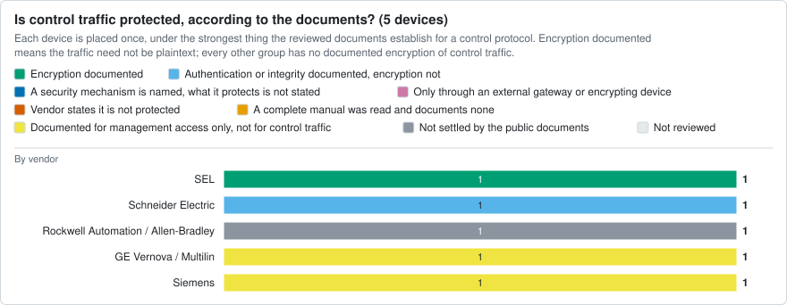
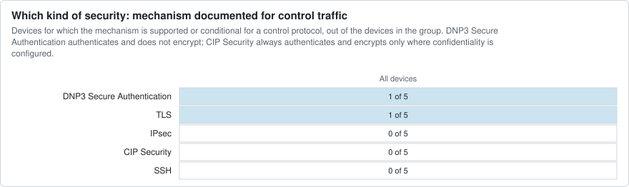
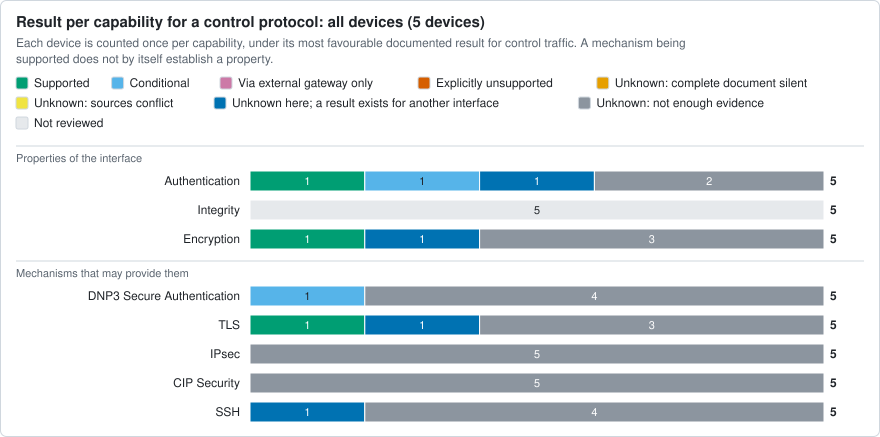
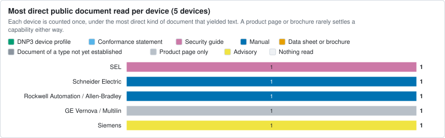
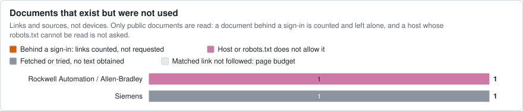
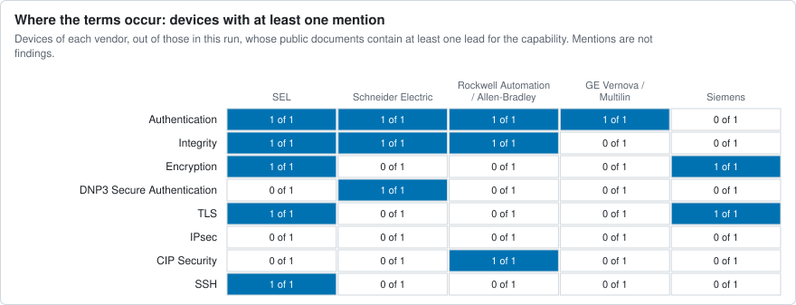

# IED security documentation survey

Sampling: Purposive five-vendor pilot, selected to test extraction and distinctions; not representative and not an estimate of prevalence.

Products/families in seed inventory: 5. Sources attempted: 7; extracted: 5; failed: 2.

This measures documented capabilities, not enabled settings, installed-base coverage or plaintext prevalence. Unknown is not unsupported. Family-level evidence is not proof for every model/firmware. Capability categories overlap, so counts below are review cells and must not be added up as devices.

Reviewers on record: Claude AI draft review; author confirmation pending (42 rows).

Every capability has one of four results: supported, conditional, explicitly unsupported or unknown. An unknown says why where the review recorded it. "Complete document silent" means a complete manual, device profile or conformance statement was searched and does not mention the capability; it is not a vendor statement that the capability is absent.

No definition of "legacy" or of the lifecycle groups is recorded in the config of this run, so no result is counted by lifecycle group.

## At a glance

Drawn from this run alone. Every number is also in a table below, and charts/data.json holds the series behind each chart. A chart of documents or mentions describes what could be read, not what a device can do; only the chart of results does that, and only for reviewed cells.

35 of 40 cells are reviewed. What follows is what those reviewed cells establish for control traffic, such as DNP3, IEC 61850, IEC 60870-5-104, Modbus or EtherNet/IP; protection of a web page or an engineering tool is counted apart. It is what the documents say a device can do. Whether it is switched on in any installation is not known.
- All devices, 5 devices: encryption documented for 1; authentication or integrity documented, encryption not for 1; documented for management access only, not for control traffic for 2; not settled by the public documents for 1.

Of 5 devices in this run, a manual, device profile, conformance statement or security guide was read for 3, a data sheet, brochure or a document whose type is not yet established for 0, only a product page or advisory for 2, and nothing for 0. Document types are the tool's suggestion unless confirmed in the source notes (5 of 5 sources confirmed).

The search found at least one mention of authentication, integrity or encryption wording for 5 of 5 devices, and of DNP3 Secure Authentication for 1. A mention is a place to read. It may be a denial, concern another interface or another product, and its absence from a brochure says nothing.

## Control traffic, device by device

Every device with a reviewed cell, by lifecycle state. "Mechanism" lists what is supported or conditional for a control protocol. A device documented only through a product page or brochure is "not settled", which is not the same as unprotected.

| Lifecycle | Manufacturer | Model | What the documents establish | Encryption | Authentication | Integrity | Mechanism | Most direct document read |
|---|---|---|---|---|---|---|---|---|
| unknown | GE Vernova / Multilin | Multilin B90 | Documented for management access only, not for control traffic | unknown | management only | not reviewed | - | product page only |
| unknown | Rockwell Automation / Allen-Bradley | ControlLogix 5580 | Not settled by the public documents | unknown | unknown | not reviewed | - | manual |
| unknown | SEL | RTAC family (guide scope) | Encryption documented | supported | supported | not reviewed | TLS | security guide |
| unknown | Schneider Electric | PowerLogic ADVC Controller | Authentication or integrity documented, encryption not | unknown | conditional | not reviewed | DNP3 Secure Authentication (conditional) | manual |
| unknown | Siemens | SIPROTEC 5 family | Documented for management access only, not for control traffic | management only | unknown | not reviewed | - | advisory |

## Devices

Identity level says whether the entry is a product family, one model or one catalogue number. Lifecycle status rests only on what the vendor says in a dated source; the date is the one the vendor states or, failing that, the day the source was retrieved. Release date is recorded apart and decides nothing. Exact model, hardware revision and firmware are stated per finding below, as the cited document names them.

| Manufacturer | Model | Category | Identity level | Lifecycle status | Dated vendor evidence | Release date |
|---|---|---|---|---|---|---|
| SEL | RTAC family (guide scope) | automation_controller | not established | unknown | none | not established |
| Schneider Electric | PowerLogic ADVC Controller | recloser_controller | not established | unknown | none | not established |
| Rockwell Automation / Allen-Bradley | ControlLogix 5580 | plc | not established | unknown | none | not established |
| GE Vernova / Multilin | Multilin B90 | protective_relay | not established | unknown | none | not established |
| Siemens | SIPROTEC 5 family | protective_relay | not established | unknown | none | not established |

## Summary by vendor and category

Devices, counted once each, by what the review established for a control protocol. "In the catalogue" is the number of classified entries in the vendor catalogue for that stratum, where the config was drawn from an inventory. A stratum with few devices in this run supports no generalisation.

| Vendor | Category | Lifecycle | In the catalogue | In this run | Authentication of a control protocol | Integrity of a control protocol | Encryption of a control protocol |
|---|---|---|---|---|---|---|---|
| GE Vernova / Multilin | protective_relay | - | - | 1 | 1 unknown: other interface only | 1 not reviewed | 1 unknown |
| Rockwell Automation / Allen-Bradley | plc | - | - | 1 | 1 unknown | 1 not reviewed | 1 unknown |
| SEL | automation_controller | - | - | 1 | 1 supported | 1 not reviewed | 1 supported |
| Schneider Electric | recloser_controller | - | - | 1 | 1 conditional | 1 not reviewed | 1 unknown |
| Siemens | protective_relay | - | - | 1 | 1 unknown | 1 not reviewed | 1 unknown: other interface only |

## Findings by product and interface

One row per product and interface. Authentication, integrity and encryption are stated for that interface only; a result for a management interface says nothing about control traffic. "Evidence applies to" is the exact model, hardware revision and firmware the cited documents name. Default, activation and deployment are stated for supported and conditional findings. Full quotes are under "Findings and evidence" and in findings_table.csv; source references are resolved under "Sources examined".

| Manufacturer | Model | Lifecycle | Evidence applies to | Protocol / interface | Authentication | Integrity | Encryption | Support conditions | Default | Activation | Deployment | Evidence | Review status |
|---|---|---|---|---|---|---|---|---|---|---|---|---|---|
| SEL | RTAC family (guide scope) | unknown | model not assessed, hardware not assessed, firmware Not stated; white paper LWP0018-01, date code 20160111 | DNP3 server to SCADA master (control protocol) | supported: X.509 certificate authentication of the TLS session, one-way or two-way | not assessed; see tls (supported) | supported: TLS encryption of the DNP3 server session | not assessed: Activated X.509 certificate and SSL/TLS selected as the serial tunnelling mode; not assessed: Client CA chain installed on the RTAC for two-way authentication | not assessed | not assessed | unknown | S1 [security guide] pdf-page:10: "Configuring a DNP3 Server to Support TLS One-Way Authentication in ACSELERATOR RTAC" (+6 more) | draft (Claude AI draft review; author confirmation pending) |
| SEL | RTAC family (guide scope) | unknown | model not assessed, hardware not assessed, firmware Not stated for SSH and password login; multifactor authentication and file transfer through the SEL server need R136 or later; white paper date code 20160111 | Engineering access through the SEL server (management) | supported: Username and password, LDAP accounts or SSH authorized keys; multifactor authentication from firmware R136 | not assessed; see ssh (supported) | supported: SSH-encrypted engineering session; a TLS tunnel is the stated alternative | not assessed: SEL server configured with SSH as the serial tunnel mode; not assessed: Perform Authentication enabled, which SSH tunnel mode sets automatically | not assessed | not assessed | unknown | S1 [security guide] pdf-page:7: "The SSH tunnel method is used in this example because it is widely used and is supported by many free [...]" (+8 more) | draft (Claude AI draft review; author confirmation pending) |
| SEL | RTAC family (guide scope) | unknown | model not assessed, hardware not assessed, firmware Not stated; white paper LWP0018-01, date code 20160111 | Web interface (management) | not assessed; see tls (supported) | not assessed; see tls (supported) | supported: HTTPS (TLS) for the web server session | not assessed | not assessed | not assessed | unknown | S1 [security guide] pdf-page:9: "The SEL RTAC web server is only accessible through HTTPS (HTTP tunneled through a TLS connection)." (+3 more) | draft (Claude AI draft review; author confirmation pending) |
| Schneider Electric | PowerLogic ADVC Controller | unknown | model not assessed, hardware not assessed, firmware Not stated; operations manual PKR39809-02 | DNP3 master station to outstation (control protocol) | conditional: DNP3 Secure Authentication version 5: per-user update keys, HMAC-SHA-256 or HMAC-SHA-1 message authentication codes | not assessed; see dnp3_secure_authentication (conditional) | unknown | not assessed: DNP3 Security made available through Feature Selection in WSOS, then Secure Authentication switched on and configured in WSOS; applies to critical ASDUs only | not assessed | not assessed | unknown | S2 [manual] html-block:1971: "The PowerLogic ADVC Controller implements version 5 of the secure authentication feature as specified in the [...]" (+5 more) | draft (Claude AI draft review; author confirmation pending) |
| Rockwell Automation / Allen-Bradley | ControlLogix 5580 | unknown | not established | No control protocol established from the examined sources | unknown | not reviewed | unknown | - | - | - | unknown | none | draft (Claude AI draft review; author confirmation pending) |
| GE Vernova / Multilin | Multilin B90 | unknown | not established | No control protocol established from the examined sources | unknown | not reviewed | unknown | - | - | - | unknown | none | draft (Claude AI draft review; author confirmation pending) |
| GE Vernova / Multilin | Multilin B90 | unknown | model not assessed, hardware not assessed, firmware CyberSentry UR, FW v7.4xx as given in the section heading | User access to the relay (management) | conditional: RADIUS (AAA) user authentication with role-based access control | not reviewed | unknown | not assessed: CyberSentry, on the firmware line named in the section heading | not assessed | not assessed | unknown | S4 [product page] html-block:153: "The standard “Remote Authentication Dial In User Service” (Radius) is used for authentication." (+2 more) | draft (Claude AI draft review; author confirmation pending) |
| Siemens | SIPROTEC 5 family | unknown | not established | No control protocol established from the examined sources | unknown | not reviewed | unknown | - | - | - | unknown | none | draft (Claude AI draft review; author confirmation pending) |
| Siemens | SIPROTEC 5 family | unknown | model not assessed, hardware not assessed, firmware Per device type: fixed from V8.89, V8.90, V9.62, V9.64 or V9.65; for some types no fix is planned | Web, DIGSI 5 and syslog interfaces (management) | unknown; see tls (conditional) | not assessed; see tls (conditional) | conditional: Encrypted management connections (web, DIGSI 5, syslog over TLS) | not assessed: Affected versions accept weak ciphers; a fixed version is needed where one exists | not assessed | not assessed | unknown | S5 [advisory] html-block:435: "The affected devices are supporting weak ciphers on several ports (443/tcp for web, 4443/tcp for DIGSI 5 and [...]" (+3 more) | draft (Claude AI draft review; author confirmation pending) |

## Counts by category

Products, not leads or table rows. Each product is counted once per capability, under its most favourable documented result for a control protocol. Unknown is one result; the four columns after it say why. "Other interface only" means a result exists for a management or network interface but none for a control protocol. A capability reached only through an external gateway is counted apart and is not the device's own. The last column is the denominator.

| Category | Capability | Supported | Conditional | Via external gateway only | Explicitly unsupported | Unknown | of which complete document silent | of which sources conflict | of which other interface only | of which not enough evidence | Not reviewed | Products |
|---|---|---|---|---|---|---|---|---|---|---|---|---|
| automation_controller | dnp3_secure_authentication | 0 | 0 | 0 | 0 | 1 | 0 | 0 | 0 | 1 | 0 | 1 |
| automation_controller | tls | 1 | 0 | 0 | 0 | 0 | 0 | 0 | 0 | 0 | 0 | 1 |
| automation_controller | ipsec | 0 | 0 | 0 | 0 | 1 | 0 | 0 | 0 | 1 | 0 | 1 |
| automation_controller | cip_security | 0 | 0 | 0 | 0 | 1 | 0 | 0 | 0 | 1 | 0 | 1 |
| automation_controller | authentication | 1 | 0 | 0 | 0 | 0 | 0 | 0 | 0 | 0 | 0 | 1 |
| automation_controller | encryption | 1 | 0 | 0 | 0 | 0 | 0 | 0 | 0 | 0 | 0 | 1 |
| automation_controller | ssh | 0 | 0 | 0 | 0 | 1 | 0 | 0 | 1 | 0 | 0 | 1 |
| automation_controller | integrity | 0 | 0 | 0 | 0 | 0 | 0 | 0 | 0 | 0 | 1 | 1 |
| recloser_controller | dnp3_secure_authentication | 0 | 1 | 0 | 0 | 0 | 0 | 0 | 0 | 0 | 0 | 1 |
| recloser_controller | tls | 0 | 0 | 0 | 0 | 1 | 0 | 0 | 0 | 1 | 0 | 1 |
| recloser_controller | ipsec | 0 | 0 | 0 | 0 | 1 | 0 | 0 | 0 | 1 | 0 | 1 |
| recloser_controller | cip_security | 0 | 0 | 0 | 0 | 1 | 0 | 0 | 0 | 1 | 0 | 1 |
| recloser_controller | authentication | 0 | 1 | 0 | 0 | 0 | 0 | 0 | 0 | 0 | 0 | 1 |
| recloser_controller | encryption | 0 | 0 | 0 | 0 | 1 | 0 | 0 | 0 | 1 | 0 | 1 |
| recloser_controller | ssh | 0 | 0 | 0 | 0 | 1 | 0 | 0 | 0 | 1 | 0 | 1 |
| recloser_controller | integrity | 0 | 0 | 0 | 0 | 0 | 0 | 0 | 0 | 0 | 1 | 1 |
| plc | dnp3_secure_authentication | 0 | 0 | 0 | 0 | 1 | 0 | 0 | 0 | 1 | 0 | 1 |
| plc | tls | 0 | 0 | 0 | 0 | 1 | 0 | 0 | 0 | 1 | 0 | 1 |
| plc | ipsec | 0 | 0 | 0 | 0 | 1 | 0 | 0 | 0 | 1 | 0 | 1 |
| plc | cip_security | 0 | 0 | 0 | 0 | 1 | 0 | 0 | 0 | 1 | 0 | 1 |
| plc | authentication | 0 | 0 | 0 | 0 | 1 | 0 | 0 | 0 | 1 | 0 | 1 |
| plc | encryption | 0 | 0 | 0 | 0 | 1 | 0 | 0 | 0 | 1 | 0 | 1 |
| plc | ssh | 0 | 0 | 0 | 0 | 1 | 0 | 0 | 0 | 1 | 0 | 1 |
| plc | integrity | 0 | 0 | 0 | 0 | 0 | 0 | 0 | 0 | 0 | 1 | 1 |
| protective_relay | dnp3_secure_authentication | 0 | 0 | 0 | 0 | 2 | 0 | 0 | 0 | 2 | 0 | 2 |
| protective_relay | tls | 0 | 0 | 0 | 0 | 2 | 0 | 0 | 1 | 1 | 0 | 2 |
| protective_relay | ipsec | 0 | 0 | 0 | 0 | 2 | 0 | 0 | 0 | 2 | 0 | 2 |
| protective_relay | cip_security | 0 | 0 | 0 | 0 | 2 | 0 | 0 | 0 | 2 | 0 | 2 |
| protective_relay | authentication | 0 | 0 | 0 | 0 | 2 | 0 | 0 | 1 | 1 | 0 | 2 |
| protective_relay | encryption | 0 | 0 | 0 | 0 | 2 | 0 | 0 | 1 | 1 | 0 | 2 |
| protective_relay | ssh | 0 | 0 | 0 | 0 | 2 | 0 | 0 | 0 | 2 | 0 | 2 |
| protective_relay | integrity | 0 | 0 | 0 | 0 | 0 | 0 | 0 | 0 | 0 | 2 | 2 |

## Capability matrix

S supported, C conditional, G only through an external gateway, X explicitly unsupported, ? unknown (?s a complete document was searched and is silent, ?c sources conflict), - not reviewed. A mark in parentheses is established only for a management or network interface, not for a control protocol.

| Product | Category | dnp3_secure_authentication | tls | ipsec | cip_security | authentication | encryption | ssh | integrity |
|---|---|---|---|---|---|---|---|---|---|
| RTAC family (guide scope) | automation_controller | ? | S | ? | ? | S | S | (S) | - |
| PowerLogic ADVC Controller | recloser_controller | C | ? | ? | ? | C | ? | ? | - |
| ControlLogix 5580 | plc | ? | ? | ? | ? | ? | ? | ? | - |
| Multilin B90 | protective_relay | ? | ? | ? | ? | (C) | ? | ? | - |
| SIPROTEC 5 family | protective_relay | ? | (C) | ? | ? | ? | (C) | ? | - |

## Default configuration, activation and deployment

Findings with a supported or conditional result, one per capability and interface. "Undocumented" means the documents read do not say whether the capability is on by default; "not assessed" means the reviewer has not looked yet. Neither means disabled.

| Capability | Findings | Default enabled | Default disabled | Default undocumented | Default not assessed | Activation needs stated | Activation: none stated | Activation not assessed |
|---|---|---|---|---|---|---|---|---|
| dnp3_secure_authentication | 1 | 0 | 0 | 0 | 1 | 0 | 0 | 1 |
| tls | 3 | 0 | 0 | 0 | 3 | 0 | 0 | 3 |
| authentication | 4 | 0 | 0 | 0 | 4 | 0 | 0 | 4 |
| encryption | 4 | 0 | 0 | 0 | 4 | 0 | 0 | 4 |
| ssh | 1 | 0 | 0 | 0 | 1 | 0 | 0 | 1 |

Deployment status is unknown for 13 of 13 findings. Vendor documents show what a device can do, not what an operator has enabled, so enabled or disabled in practice is recorded only where evidence from an installation is cited.

## Findings and evidence

Every row that rests on cited sources: each result, and each unknown recorded because a complete document is silent or sources conflict. Quotes are verbatim from the cited location of the retained source.

### RTAC family (guide scope): tls (supported)

- Interface: DNP3 server to SCADA master (control protocol)
- Protocol: TLS tunnel around the DNP3 server (SSL/TLS serial tunnelling mode), TLS 1.0 and above
- Firmware: Not stated; white paper LWP0018-01, date code 20160111
- Implementation: Built into the RTAC platform
- Conditions: Activated X.509 certificate and SSL/TLS selected as the serial tunnelling mode
- Location: pdf-page:9 to pdf-page:10, Figures 9 and 10
- Support basis: not assessed
- Default configuration: not assessed
- Activation: not assessed
- Deployment: unknown
- Evidence, pdf-page:10: "Configuring a DNP3 Server to Support TLS One-Way Authentication in ACSELERATOR RTAC"
- Evidence, pdf-page:9: "Any serial protocol, with the exception of MIRRORED BITS® communications, can be tunneled through a TLS connection"
- Evidence, pdf-page:9: "The SEL RTAC only supports TLS 1.0 and above due to security vulnerabilities discovered in SSL 3.0 and earlier."
- Source: S1 [security guide] https://selinc.com/api/download/112760/
- Review status: draft (Claude AI draft review; author confirmation pending)

### RTAC family (guide scope): encryption (supported)

- Interface: DNP3 server to SCADA master (control protocol)
- Protocol: TLS encryption of the DNP3 server session
- Firmware: Not stated; white paper LWP0018-01, date code 20160111
- Implementation: Built in; a TLS tunnel around the serial protocol, not an encrypted mode of DNP3 itself
- Conditions: Activated X.509 certificate and SSL/TLS selected as the serial tunnelling mode
- Location: pdf-page:9 to pdf-page:10
- Support basis: not assessed
- Default configuration: not assessed
- Activation: not assessed
- Deployment: unknown
- Evidence, pdf-page:10: "After the X.509 certificate is activated, it is a simple step to encrypt the server communications."
- Evidence, pdf-page:9: "The PKI infrastructure also allows users to encrypt SCADA communication."
- Source: S1 [security guide] https://selinc.com/api/download/112760/
- Review status: draft (Claude AI draft review; author confirmation pending)

### RTAC family (guide scope): authentication (supported)

- Interface: DNP3 server to SCADA master (control protocol)
- Protocol: X.509 certificate authentication of the TLS session, one-way or two-way
- Firmware: Not stated; white paper LWP0018-01, date code 20160111
- Implementation: Built in; certificate based
- Conditions: Client CA chain installed on the RTAC for two-way authentication
- Location: pdf-page:10, Figures 9 and 10
- Support basis: not assessed
- Default configuration: not assessed
- Activation: not assessed
- Deployment: unknown
- Evidence, pdf-page:10: "For one-way authentication where only the client (i.e., SCADA) is authenticating the certificates, all that is required is to select SSL/TLS as the Serial Tunneling Mode"
- Evidence, pdf-page:10: "In this mode, the server also authenticates the client’s (SCADA) certificate to ensure that the incoming connection originates from a trusted source."
- Source: S1 [security guide] https://selinc.com/api/download/112760/
- Review status: draft (Claude AI draft review; author confirmation pending)

### RTAC family (guide scope): ssh (supported)

- Interface: Engineering access through the SEL server (management)
- Protocol: SSH tunnel for SEL-protocol terminal access, with SSH authorized keys
- Firmware: Not stated for SSH and password login; multifactor authentication and file transfer through the SEL server need R136 or later; white paper date code 20160111
- Implementation: Built in
- Conditions: SEL server configured with SSH as the serial tunnel mode
- Location: pdf-page:7 to pdf-page:9, Figures 7 and 8
- Support basis: not assessed
- Default configuration: not assessed
- Activation: not assessed
- Deployment: unknown
- Evidence, pdf-page:7: "The SSH tunnel method is used in this example because it is widely used and is supported by many free terminal applications."
- Evidence, pdf-page:8: "Note that when SSH is the serial tunnel mode, then Perform Authentication is automatically configured to True."
- Evidence, pdf-page:9: "Through the web interface at Security > SSH Keys, a user can add preauthorized public keys for authentication."
- Source: S1 [security guide] https://selinc.com/api/download/112760/
- Review status: draft (Claude AI draft review; author confirmation pending)

### RTAC family (guide scope): encryption (supported)

- Interface: Engineering access through the SEL server (management)
- Protocol: SSH-encrypted engineering session; a TLS tunnel is the stated alternative
- Firmware: Not stated for SSH and password login; multifactor authentication and file transfer through the SEL server need R136 or later; white paper date code 20160111
- Implementation: Built in
- Conditions: SEL server configured with SSH as the serial tunnel mode
- Location: pdf-page:7
- Support basis: not assessed
- Default configuration: not assessed
- Activation: not assessed
- Deployment: unknown
- Evidence, pdf-page:7: "Secure engineering access into the SEL RTAC requires encrypting the user session so that valuable information is not readable via plain text."
- Evidence, pdf-page:7: "Secure Shell (SSH) is a widely used cryptographic network protocol that provides terminal access to remote devices."
- Evidence, pdf-page:7: "A TLS tunnel is another option for securing engineering access and is described in Section 6"
- Source: S1 [security guide] https://selinc.com/api/download/112760/
- Review status: draft (Claude AI draft review; author confirmation pending)

### RTAC family (guide scope): authentication (supported)

- Interface: Engineering access through the SEL server (management)
- Protocol: Username and password, LDAP accounts or SSH authorized keys; multifactor authentication from firmware R136
- Firmware: Not stated for SSH and password login; multifactor authentication and file transfer through the SEL server need R136 or later; white paper date code 20160111
- Implementation: Built in; local or centrally managed (LDAP) accounts
- Conditions: Perform Authentication enabled, which SSH tunnel mode sets automatically
- Location: pdf-page:8 to pdf-page:9
- Support basis: not assessed
- Default configuration: not assessed
- Activation: not assessed
- Deployment: unknown
- Evidence, pdf-page:8: "The SEL server also supports the capability to enforce authentication before granting access to the command line interface."
- Evidence, pdf-page:8: "Local accounts and centrally managed accounts (i.e., those configured through Lightweight Directory Access Protocol [LDAP]) can be used to authenticate to the SEL server."
- Evidence, pdf-page:9: "In SEL RTAC firmware Version R136 and above, multifactor authentication is available in the SEL server."
- Source: S1 [security guide] https://selinc.com/api/download/112760/
- Review status: draft (Claude AI draft review; author confirmation pending)

### RTAC family (guide scope): tls (supported)

- Interface: Web interface (management)
- Protocol: HTTPS only, TLS 1.0 and above
- Firmware: Not stated; white paper LWP0018-01, date code 20160111
- Implementation: Built in; self-signed X.509 certificate enabled by default
- Location: pdf-page:4, Table 2; pdf-page:9
- Support basis: not assessed
- Default configuration: not assessed
- Activation: not assessed
- Deployment: unknown
- Evidence, pdf-page:9: "The SEL RTAC web server is only accessible through HTTPS (HTTP tunneled through a TLS connection)."
- Evidence, pdf-page:4: "443 HTTPS (Transport Layer Security-encrypted [TLS-encrypted] RTAC web server session)"
- Source: S1 [security guide] https://selinc.com/api/download/112760/
- Review status: draft (Claude AI draft review; author confirmation pending)

### RTAC family (guide scope): encryption (supported)

- Interface: Web interface (management)
- Protocol: HTTPS (TLS) for the web server session
- Firmware: Not stated; white paper LWP0018-01, date code 20160111
- Implementation: Built in; self-signed X.509 certificate enabled by default
- Location: pdf-page:4, Table 2; pdf-page:9
- Support basis: not assessed
- Default configuration: not assessed
- Activation: not assessed
- Deployment: unknown
- Evidence, pdf-page:9: "The SEL RTAC web server is only accessible through HTTPS (HTTP tunneled through a TLS connection)."
- Evidence, pdf-page:9: "By default, all SEL RTACs have a self- signed X.509 certificate enabled."
- Source: S1 [security guide] https://selinc.com/api/download/112760/
- Review status: draft (Claude AI draft review; author confirmation pending)

### PowerLogic ADVC Controller: dnp3_secure_authentication (conditional)

- Interface: DNP3 master station to outstation (control protocol)
- Protocol: DNP3 Secure Authentication version 5 (IEEE 1815-2012)
- Firmware: Not stated; operations manual PKR39809-02
- Implementation: Native controller feature
- Conditions: DNP3 Security made available through Feature Selection in WSOS, then Secure Authentication switched on and configured in WSOS; applies to critical ASDUs only
- Location: html-block:1971 to html-block:2016, section "DNP3 Security"
- Support basis: not assessed
- Default configuration: not assessed
- Activation: not assessed
- Deployment: unknown
- Evidence, html-block:1971: "The PowerLogic ADVC Controller implements version 5 of the secure authentication feature as specified in the IEEE standard document 1815-2012."
- Evidence, html-block:1973: "DNP3 and DNP3 Security must firstly be made available through Feature Selection in WSOS."
- Evidence, html-block:1972: "DNP3 Secure Authentication functionality for the PowerLogic ADVC Controller can only be enabled and configured through WSOS."
- Source: S2 [manual] https://productinfo.se.com/advc-operationsmanual/pkr39809_advc_operations-manual/English/BM_ADVC3%20Operations%20Manual_0000999204.xml/$/TPC_ADVC3_OM_DNP3SecurityCPT_0001009251
- Review status: draft (Claude AI draft review; author confirmation pending)

### PowerLogic ADVC Controller: authentication (conditional)

- Interface: DNP3 master station to outstation (control protocol)
- Protocol: DNP3 Secure Authentication version 5: per-user update keys, HMAC-SHA-256 or HMAC-SHA-1 message authentication codes
- Firmware: Not stated; operations manual PKR39809-02
- Implementation: Native controller feature
- Conditions: DNP3 Security made available through Feature Selection in WSOS, then Secure Authentication switched on and configured in WSOS; applies to critical ASDUs only
- Location: html-block:1980 to html-block:2016, Table 19
- Support basis: not assessed
- Default configuration: not assessed
- Activation: not assessed
- Deployment: unknown
- Evidence, html-block:1993: "This determines which algorithm the controller uses to encode the MAC in DNP3 Secure Authentication messages."
- Evidence, html-block:2007: "DNP3 Secure Authentication is performed on a per-user basis."
- Evidence, html-block:2014: "Secure Authentication is required for accessing critical ASDU’s only."
- Source: S2 [manual] https://productinfo.se.com/advc-operationsmanual/pkr39809_advc_operations-manual/English/BM_ADVC3%20Operations%20Manual_0000999204.xml/$/TPC_ADVC3_OM_DNP3SecurityCPT_0001009251
- Review status: draft (Claude AI draft review; author confirmation pending)

### Multilin B90: authentication (conditional)

- Interface: User access to the relay (management)
- Protocol: RADIUS (AAA) user authentication with role-based access control
- Firmware: CyberSentry UR, FW v7.4xx as given in the section heading
- Implementation: CyberSentry feature set of the UR family; the page does not say whether it is a separately ordered option
- Conditions: CyberSentry, on the firmware line named in the section heading
- Location: html-block:144 to html-block:153, CyberSentry section
- Support basis: not assessed
- Default configuration: not assessed
- Activation: not assessed
- Deployment: unknown
- Evidence, html-block:153: "The standard “Remote Authentication Dial In User Service” (Radius) is used for authentication."
- Evidence, html-block:151: "Enables integration with centrally managed authentication and accounting of all user activities"
- Evidence, html-block:144: "Cyber Security - CyberSentry™ UR (FW v7.4xx)"
- Source: S4 [product page] https://www.gevernova.com/electrification/automation/protection-control-metering/bus-protection/multilin-b90
- Review status: draft (Claude AI draft review; author confirmation pending)

### SIPROTEC 5 family: tls (conditional)

- Interface: Web, DIGSI 5 and syslog interfaces (management)
- Protocol: TLS on HTTPS (443/tcp), DIGSI 5 (4443/tcp) and syslog over TLS
- Firmware: Per device type: fixed from V8.89, V8.90, V9.62, V9.64 or V9.65; for some types no fix is planned
- Implementation: Built into the SIPROTEC 5 and SIPROTEC 5 Compact device types listed in the advisory
- Conditions: Affected versions accept weak ciphers; a fixed version is needed where one exists
- Location: html-block:424 and html-block:435
- Support basis: not assessed
- Default configuration: not assessed
- Activation: not assessed
- Deployment: unknown
- Evidence, html-block:435: "The affected devices are supporting weak ciphers on several ports (443/tcp for web, 4443/tcp for DIGSI 5 and configurable port for syslog over TLS)."
- Evidence, html-block:424: "Restrict access to port 443/tcp for web, 4443/tcp for DIGSI 5 and configurable port for syslog over TLS to trusted IP addresses only"
- Source: S5 [advisory] https://cert-portal.siemens.com/productcert/html/ssa-750499.html
- Review status: draft (Claude AI draft review; author confirmation pending)

### SIPROTEC 5 family: encryption (conditional)

- Interface: Web, DIGSI 5 and syslog interfaces (management)
- Protocol: Encrypted management connections (web, DIGSI 5, syslog over TLS)
- Firmware: Per device type: fixed from V8.89, V8.90, V9.62, V9.64 or V9.65; for some types no fix is planned
- Implementation: Built into the SIPROTEC 5 and SIPROTEC 5 Compact device types listed in the advisory
- Conditions: Affected versions accept weak ciphers; a fixed version is needed where one exists
- Location: html-block:12 and html-block:435
- Support basis: not assessed
- Default configuration: not assessed
- Activation: not assessed
- Deployment: unknown
- Evidence, html-block:12: "The SIPROTEC 5 devices are supporting weak encryption. This could allow an unauthorized attacker in a man-in-the-middle position to read any data passed over the connection between legitimate clients and the affected device."
- Evidence, html-block:435: "The affected devices are supporting weak ciphers on several ports (443/tcp for web, 4443/tcp for DIGSI 5 and configurable port for syslog over TLS)."
- Source: S5 [advisory] https://cert-portal.siemens.com/productcert/html/ssa-750499.html
- Review status: draft (Claude AI draft review; author confirmation pending)

## Reviewed rows

| Product | Capability | Interface | Review result | Scope |
|---|---|---|---|---|
| RTAC family (guide scope) | dnp3_secure_authentication | - | unknown | The white paper mentions DNP3 as a server protocol and as the example carried over TLS. It does not mention DNP3 Secure Authentication. Not a non-support finding. |
| RTAC family (guide scope) | tls | DNP3 server to SCADA master | supported | The white paper documents TLS for SCADA server communications on the RTAC platform, with a DNP3 server as the worked example. No firmware, module or licence condition is stated; the certificate and the tunnelling-mode setting are configuration. The evidence is family-level and dated 2016, so confirm it against the current instruction manual for a specific RTAC model and firmware before generalizing. It is a capability of the RTAC as data concentrator, not of the relays behind it. |
| RTAC family (guide scope) | encryption | DNP3 server to SCADA master | supported | Encryption of SCADA traffic is documented as a TLS tunnel around the serial protocol. The same section says power-system information is often transmitted in plain text, so this is an optional capability and says nothing about how often it is used. The evidence is family-level and dated 2016, so confirm it against the current instruction manual for a specific RTAC model and firmware before generalizing. It is a capability of the RTAC as data concentrator, not of the relays behind it. |
| RTAC family (guide scope) | authentication | DNP3 server to SCADA master | supported | This authenticates the endpoints of the TLS session that carries DNP3. It is not DNP3 Secure Authentication, which authenticates individual critical messages and which the paper does not mention. The evidence is family-level and dated 2016, so confirm it against the current instruction manual for a specific RTAC model and firmware before generalizing. It is a capability of the RTAC as data concentrator, not of the relays behind it. |
| RTAC family (guide scope) | ssh | Engineering access through the SEL server | supported | SSH is documented for engineering access to the RTAC and to the IEDs behind it. The paper adds that serial protocols can also be tunnelled through SSH but gives no DNP3 example, so this row is scoped to engineering access. |
| RTAC family (guide scope) | encryption | Engineering access through the SEL server | supported | Encryption of the engineering session, not of SCADA traffic. Recorded separately so it is not read as DNP3 encryption. |
| RTAC family (guide scope) | authentication | Engineering access through the SEL server | supported | User authentication for engineering access. It says who may open a terminal session, not whether control messages are authenticated. |
| RTAC family (guide scope) | tls | Web interface | supported | Encrypted web administration. This passage does not establish encrypted DNP3; that is the separate DNP3 server row. |
| RTAC family (guide scope) | encryption | Web interface | supported | Encryption of the web interface only. |
| RTAC family (guide scope) | ipsec | - | unknown | The white paper does not mention IPsec or VPN. Not a non-support finding. |
| RTAC family (guide scope) | cip_security | - | unknown | The white paper does not mention ODVA CIP Security. Not a non-support finding. |
| PowerLogic ADVC Controller | dnp3_secure_authentication | DNP3 master station to outstation | conditional | The manual states Secure Authentication version 5 for the controller. Conditional because the feature has to be made available through Feature Selection and then switched on; while off, the controller requires no authentication. This establishes message authentication, not encryption of DNP3 payloads. |
| PowerLogic ADVC Controller | tls | - | unknown | Only the "DNP3 Security" section of the operations manual was examined. It does not mention TLS. Not a non-support finding. |
| PowerLogic ADVC Controller | ipsec | - | unknown | Only the "DNP3 Security" section of the operations manual was examined. It does not mention IPsec or VPN. Not a non-support finding. |
| PowerLogic ADVC Controller | cip_security | - | unknown | Only the "DNP3 Security" section of the operations manual was examined. It does not mention ODVA CIP Security. Not a non-support finding. |
| PowerLogic ADVC Controller | authentication | DNP3 master station to outstation | conditional | Same capability as the DNP3 Secure Authentication row, recorded here because the two categories overlap; it is one capability, not two. Login authentication of users or engineering tools is not covered by the examined section. |
| PowerLogic ADVC Controller | encryption | - | unknown | Only the "DNP3 Security" section of the operations manual was examined. It describes message authentication codes and does not mention encryption of DNP3 traffic. Not a non-support finding. |
| PowerLogic ADVC Controller | ssh | - | unknown | Only the "DNP3 Security" section of the operations manual was examined. It does not mention SSH. Not a non-support finding. |
| ControlLogix 5580 | dnp3_secure_authentication | - | unknown | The examined manual page does not mention DNP3. Not a non-support finding. |
| ControlLogix 5580 | tls | - | unknown | The examined manual page does not name TLS or DTLS. Not a non-support finding. |
| ControlLogix 5580 | ipsec | - | unknown | The examined manual page does not mention IPsec or VPN. Not a non-support finding. |
| ControlLogix 5580 | cip_security | - | unknown | The 5580 user manual page describes CIP Security in general terms and refers to "CIP Security-enabled Logix controllers" (html-block:15), but it does not state that the ControlLogix 5580 is CIP Security-capable or from which firmware revision. It defers the list of capable products and minimum firmware revisions to publication SECURE-AT001 (html-block:19), whose download failed in this run because the robots.txt of that host was unresolved. Left unknown rather than inferred. Not a non-support finding. |
| ControlLogix 5580 | authentication | - | unknown | The page says CIP Security lets devices authenticate each other (html-block:7) as a description of the standard. Whether and from which firmware that applies to the 5580 depends on the publication that could not be fetched. Not a non-support finding. |
| ControlLogix 5580 | encryption | - | unknown | The page lists data confidentiality as a CIP Security property (html-block:11) as a description of the standard, not as a stated capability of the 5580. Not a non-support finding. |
| ControlLogix 5580 | ssh | - | unknown | The examined manual page does not mention SSH. Not a non-support finding. |
| Multilin B90 | dnp3_secure_authentication | - | unknown | The product page lists "DNP 3.0 (serial & TCP/IP)" as a supported protocol (html-block:137) and does not mention Secure Authentication. Not a non-support finding. |
| Multilin B90 | tls | - | unknown | The product page does not mention TLS. Not a non-support finding. |
| Multilin B90 | ipsec | - | unknown | The product page does not mention IPsec or VPN. Not a non-support finding. |
| Multilin B90 | cip_security | - | unknown | The product page does not mention ODVA CIP Security. Its references to NERC CIP are a regulatory standard, not this protocol. Not a non-support finding. |
| Multilin B90 | authentication | User access to the relay | conditional | The product page documents RADIUS-based user authentication and roles under CyberSentry, tied to a firmware line. This concerns who may log in to the relay. The firmware-file hash check on the same page verifies firmware, not users or messages, and is not used here. It is a product page with no document revision or date. |
| Multilin B90 | authentication | - | unknown | For control protocols: the page lists DNP 3.0 as a supported protocol and says nothing about authenticating its messages. The RADIUS finding is recorded separately for user access. Not a non-support finding. |
| Multilin B90 | encryption | - | unknown | The product page makes no explicit statement about encrypted communication. Not a non-support finding. |
| Multilin B90 | ssh | - | unknown | The page lists "HTTP, TFTP, SFTP and MMS file transfer" (html-block:140). SSH is not named, and the page does not say whether SFTP means SSH File Transfer or under which option it is available. Left unknown pending the UR instruction manual. Not a non-support finding. |
| SIPROTEC 5 family | dnp3_secure_authentication | - | unknown | The advisory does not address this capability, and the intended source, the security conformance statement, returned HTTP 404. Not a non-support finding. |
| SIPROTEC 5 family | tls | Web, DIGSI 5 and syslog interfaces | conditional | Indirect evidence: a vendor security advisory (SSA-750499 V1.2), not a manual. It shows that the listed devices run TLS-protected management services and that affected versions accept weak ciphers. The presence of encryption is not evidence of adequate security. The intended source, the security conformance statement, returned HTTP 404. |
| SIPROTEC 5 family | tls | - | unknown | For control protocols: the advisory names only the web, DIGSI 5 and syslog ports and says nothing about DNP3 or IEC 61850 traffic. The finding for those management interfaces is recorded separately. Not a non-support finding. |
| SIPROTEC 5 family | ipsec | - | unknown | The advisory recommends protecting network access with external mechanisms such as firewalls, segmentation and VPN (html-block:428). That is site guidance, not a device capability, and a VPN recommendation does not establish native IPsec support. Not a non-support finding. |
| SIPROTEC 5 family | cip_security | - | unknown | The advisory does not address this capability, and the intended source, the security conformance statement, returned HTTP 404. Not a non-support finding. |
| SIPROTEC 5 family | authentication | - | unknown | The advisory does not address this capability, and the intended source, the security conformance statement, returned HTTP 404. Not a non-support finding. |
| SIPROTEC 5 family | encryption | Web, DIGSI 5 and syslog interfaces | conditional | Same evidence as the TLS row: encryption exists on management interfaces and is weak in affected versions. |
| SIPROTEC 5 family | encryption | - | unknown | For control protocols: the advisory names only the web, DIGSI 5 and syslog ports and says nothing about DNP3 or IEC 61850 traffic. The finding for those management interfaces is recorded separately. Not a non-support finding. |
| SIPROTEC 5 family | ssh | - | unknown | The advisory does not address this capability, and the intended source, the security conformance statement, returned HTTP 404. Not a non-support finding. |

## Unresolved cells

31 of 40 cells are unknown or not reviewed on every interface.

- RTAC family (guide scope): dnp3_secure_authentication, ipsec, cip_security, integrity
- PowerLogic ADVC Controller: tls, ipsec, cip_security, encryption, ssh, integrity
- ControlLogix 5580: dnp3_secure_authentication, tls, ipsec, cip_security, authentication, encryption, ssh, integrity
- Multilin B90: dnp3_secure_authentication, tls, ipsec, cip_security, encryption, ssh, integrity
- SIPROTEC 5 family: dnp3_secure_authentication, ipsec, cip_security, authentication, ssh, integrity

## Sources examined

Type, number, revision and document date are what a reviewer confirmed or read off the document; "not established" and "suggested" mean nobody has yet. Types are listed in the README from most to least direct about what one product and firmware can do. Titles and PDF dates are what the file says about itself, and a PDF creation date is not necessarily a publication date.

| Ref | Product | Document | Type | Number and revision | Document date | Retrieved | SHA-256 | URL |
|---|---|---|---|---|---|---|---|---|
| S1 | RTAC family (guide scope) | SEL APPLICATION GUIDE, 14 PDF pages, PDF created 2016-01-11 | security guide, complete | LWP0018-01 | 2016-01-11 | 2026-10-13 | 379cfbfd5432e521e9dcf3028633cf34d07570aeed3e1a26f89c33dbbb1a2f20 | https://selinc.com/api/download/112760/ |
| S2 | PowerLogic ADVC Controller | DNP3 Security - PKR39809_ADVC_Operations manual | manual, partial | PKR39809, revision 02 | not established | 2026-10-13 | ce5165317858ec70d08f71a170fb3ea90935147c5262a9ffbb924329b052561f | https://productinfo.se.com/advc-operationsmanual/pkr39809_advc_operations-manual/English/BM_ADVC3%20Operations%20Manual_0000999204.xml/$/TPC_ADVC3_OM_DNP3SecurityCPT_0001009251 |
| S3 | ControlLogix 5580 | Secure Controller Systems | manual, partial | 1756-UM543 | not established | 2026-10-13 | 87af23478dc71f1ff7594a9a3f648edf92129d1088e2df9146c8423018cbf2db | https://www.rockwellautomation.com/en-us/docs/technical/logix5000/_online/1756-um543/controllogix-5580-and-guardlogix-5580-controllers-/controllogix-and-guardlogix-systems/secure-controller-systems.html |
| S4 | Multilin B90 | Multilin B90 / GE Vernova / Electrification | product page, complete | not established | not established | 2026-10-13 | bf08ebae53ad44e5180f54f474b183366be8ab9154c980609cad72cc16c7806f | https://www.gevernova.com/electrification/automation/protection-control-metering/bus-protection/multilin-b90 |
| S5 | SIPROTEC 5 family | SSA-750499 | advisory, complete | SSA-750499, revision V1.2 | 2025-11-11 | 2026-10-13 | 16b5f949dc1b8046d54701991f82f9430d504c6ee7110e9bf6fc3a8eb79e5098 | https://cert-portal.siemens.com/productcert/html/ssa-750499.html |

## Sources without extracted text

| Product | URL | Outcome |
|---|---|---|
| ControlLogix 5580 | https://literature.rockwellautomation.com/idc/groups/literature/documents/at/secure-at001_-en-p.pdf | ValueError: robots unresolved: HTTP 301 |
| SIPROTEC 5 family | https://cache.industry.siemens.com/dl/files/768/109821768/att_1145217/v1/SIP5_DIGSI5_Security_Conformance_Statement_EN.pdf | ValueError: HTTP 404 |

Review coverage: 35/40 product–capability cells. Unreviewed cells carry no result.

Evidence quotes: 13 of 13 rows with a result other than unknown carry a quote that was checked against the cited passage.

Unknown because a complete document is silent: 0 rows, each checked to cite only complete documents in which the search found no lead for that capability.

See findings.csv for source URLs, hashes, interface, firmware and review provenance, and devices.csv for lifecycle evidence. No population percentages are computed.
Re-bound rows: 14 rows were written against an earlier fetch of the same documents and re-bound because the extracted text is unchanged; each row records the hashes.
